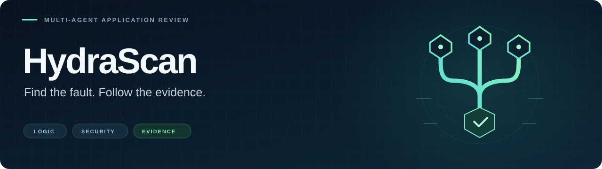
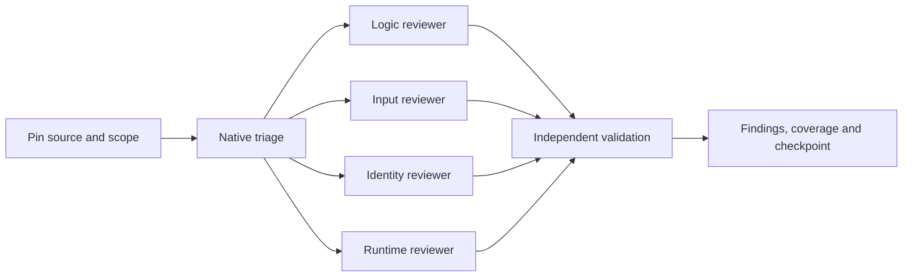

<div align="center">



**Find logic bugs, broken workflows and security vulnerabilities in apps and websites.**

Complementary reviewers. Traceable evidence. Reviews you can resume.


[Quick start](#quick-start) · [Coverage](#coverage) · [Agents](#agents) · [Validation](#validation) · [Documentation](#documentation)

</div>

---

HydraScan combines a native Python review runner with a multi-agent skill. The runner inventories source, creates a bounded text snapshot, surfaces static candidates and saves review artifacts. Your coding agent coordinates reviewers, validates findings and produces a report with evidence and remaining gaps.

The base runner uses Python's standard library. No separate scanner engine, Docker, provider account or API key is required. Full JS/TS/JSX AST analysis optionally uses Node and the pinned Babel parser. Semantic review and agent delegation are provided by the host coding agent; the CLI does not launch model agents.

## Quick start

### 1. Install the skill

In Codex, ask the skill installer:

```text
Use $skill-installer to install the skill from Omern187/HydraScan at skills/hydrascan.
```

For manual installation, copy the entire [skills/hydrascan](skills/hydrascan) folder into your skills directory as `hydrascan`, normally `~/.codex/skills/hydrascan` or `$CODEX_HOME/skills/hydrascan`. The skill is available on the next turn.

### 2. Start a review

```text
Use $hydrascan to review this app for logic bugs, broken workflows and security vulnerabilities. Use complementary agents, reproduce important findings with synthetic data, and save findings, coverage and a continuation checkpoint.
```

### 3. Run the native CLI

From a checkout of this repository:

```text
python skills/hydrascan/scripts/hydrascan.py doctor
python skills/hydrascan/scripts/hydrascan.py scan /path/to/app --output /path/to/new-run
python skills/hydrascan/scripts/hydrascan.py collect /path/to/new-run
```

Use a new run directory outside the reviewed source. For an installed skill, use the script inside the installed folder. `scan` creates inventory, candidates, check outcomes, coverage, a Markdown report and a continuation checkpoint. `collect` refreshes summaries while preserving manual notes; it does not re-test changed source.

<details>
<summary><strong>Enable optional JavaScript / TypeScript AST analysis</strong></summary>

Install the pinned parser in HydraScan's trusted runtime, separately from the reviewed app. Use a Node version supported by [the parser manifest](skills/hydrascan/scripts/javascript-parser/package.json).

```text
npm ci --prefix skills/hydrascan/scripts/javascript-parser
python skills/hydrascan/scripts/hydrascan.py doctor
```

For a separate parser installation, pass `--js-parser-root /path/to/parser-runtime` to `doctor` and `scan`, or set `HYDRASCAN_JS_PARSER_ROOT`. That directory must contain the installed `node_modules`. Select a Node executable with `--node` or `HYDRASCAN_NODE`.

The runner never installs packages automatically or loads the target app's parser configuration. Missing parsers, parse failures and resource bounds are recorded in `analysis-gaps.json`. Limited lexical fallback does not count as AST coverage.

</details>

<details>
<summary><strong>Run explicitly selected application checks</strong></summary>

Application commands execute only when supplied through `--checks /path/to/checks.json`. For example:

```json
[
  {
    "name": "unit tests",
    "argv": ["python", "-m", "unittest", "discover", "-s", "tests", "-v"],
    "timeout": 60
  }
]
```

```text
python skills/hydrascan/scripts/hydrascan.py scan /path/to/app --output /path/to/new-run --checks /path/to/checks.json
```

Checks run sequentially in the snapshot with argument arrays and no shell. Inspect the code and selected commands first: the snapshot is **not an OS/network sandbox**. Check processes can access the host environment, filesystem and network. Use an appropriately contained disposable environment for untrusted execution. See [runner details](skills/hydrascan/references/engine.md).

</details>

## Coverage

| Review angle | What reviewers investigate |
| --- | --- |
| **Logic & workflows** | Wrong results, state transitions, imports/exports, races, persistence, errors and recovery. |
| **Input & interpreters** | Query, command and template injection, XSS, SSRF, paths, files, archives and parser boundaries. |
| **Identity & trust** | Authentication, authorization, owner/tenant isolation, sessions, data exposure and API/IPC contracts. |
| **Runtime & distribution** | Alternate launchers, release assets, dependencies, resource limits, deployment and Electron boundaries. |

Native triage includes bounded Python cross-file flow, selected SQL/ORM read/write/delete authorization paths and optional JS/TS/JSX AST signals. Traces retain caller and sink locations. Unknown schema, sharing intent and external policy remain explicit proof gaps; unresolved access questions go into `security-review-tasks.json`.

The **32-family coverage ledger** starts as `not-started` or `partial`. Reviewers must supply relevant evidence before advancing coverage. Static signals and process exit codes alone do not establish a vulnerability or a clean application. See [project analysis](skills/hydrascan/references/project-analysis.md).

## Agents



| Role | Responsibility |
| --- | --- |
| **Coordinator** | Pins the revision, assigns coverage, merges evidence and tracks open work. |
| **Logic reviewer** | Challenges results, journeys, asynchronous state and failure recovery. |
| **Input reviewer** | Traces untrusted input into interpreters, renderers, files and outbound requests. |
| **Identity reviewer** | Compares roles and tenants across reads, writes, exports, jobs and trust boundaries. |
| **Runtime reviewer** | Examines startup variants, protocols, dependencies and distribution boundaries. |
| **Independent validator** | Attempts to reproduce or disprove consequential findings. |

Reviewers receive different angles, the same pinned source and private test resources. Initial discovery does not receive another reviewer's conclusions. Shared mutable tests are coordinated to avoid interference.

Roles run within the host's actual limits, using later waves where needed. A host without delegation runs review lanes sequentially and reports that limitation. Every requested coverage family and critical journey gets an owner; agreement between agents does not prove complete coverage. See the [multi-agent workflow](skills/hydrascan/references/multi-agent-review.md).

## Evidence you can follow

Each accepted finding records its source/build, preconditions, expected versus observed behavior, impact, reproduction or source trace, controls and proposed fix. Reports separate functional defects, security vulnerabilities and hardening observations.

| Proof state | What it means |
| --- | --- |
| `candidate` | Plausible concern with a named evidence or product-intent gap. |
| `source-confirmed` | Established by a complete reachable source trace. |
| `dynamic-confirmed` | Observed through a tested runtime or component, with substitutions disclosed. |
| `hardening` | An improvement without an established exploitable defect. |

Runs save inventory, candidates, analysis gaps, check results, coverage, a report and `review-state.md`. The checkpoint preserves scope, agent ownership, evidence, resources and open work. Passing existing tests does not clear untested paths; a passing bug demonstration does not verify a fix.

<details>
<summary><strong>Copy a prompt: GitHub review, resume or remediation</strong></summary>

**Review a GitHub revision**

```text
Use $hydrascan to review owner/repository from GitHub. Pin the current main commit and use an isolated checkout of that revision. Review imports, exports, authorization and asynchronous state, and report tested paths and remaining gaps.
```

**Continue an assessment**

```text
Use $hydrascan to continue the assessment from review-state.md. Verify the source revision, resume open coverage and candidates, and independently challenge consequential findings.
```

**Fix confirmed findings**

```text
Use $hydrascan to fix the confirmed findings in the saved report. Patch the root causes and verify the intended behavior with meaningful regression checks.
```

</details>

## Validation

Workflow revision **2026-10-10.10** passed **157 tooling tests** with the optional Babel backend available. These tests verify HydraScan's runner and source triage, including controls and parser regressions; they do not assess another app's security.

Run the suite from the repository root:

```text
python -m unittest discover -s tests -v
```

AST tests run when the pinned parser is installed or `HYDRASCAN_JS_PARSER_ROOT` identifies it. Otherwise that test class is explicitly skipped and fallback tests still run.

Independent synthetic cases exposed misses and false positives, retained in the evaluation history and addressed with regression tests. Re-running disclosed cases measures regression behavior, not independently demonstrated coverage of other applications.

## Documentation

| Guide | Read it for |
| --- | --- |
| [Skill entrypoint](skills/hydrascan/SKILL.md) | The complete review workflow and activation instructions. |
| [Native runner](skills/hydrascan/references/engine.md) | CLI behavior, snapshots, checks and saved artifacts. |
| [Project analysis](skills/hydrascan/references/project-analysis.md) | Supported source forms, flow analysis and limitations. |
| [Multi-agent review](skills/hydrascan/references/multi-agent-review.md) | Review lanes, scheduling and independent validation. |
| [Coverage ledger](skills/hydrascan/references/coverage.md) | Risk families, ownership and remaining gaps. |
| [Security validation](skills/hydrascan/references/security-validation.md) | Evidence requirements and controls for security findings. |
| [Functional bugs](skills/hydrascan/references/functional-bugs.md) · [Behavioral probes](skills/hydrascan/references/behavioral-probes.md) | Workflow failures and architecture-specific experiments. |
| [Reporting](skills/hydrascan/references/reporting.md) | Finding structure, proof states and continuation records. |

---

Active testing uses established authorized targets and effects, preferably disposable local instances or staging with synthetic data. A review request does not authorize production changes, additional hosts, paid/cloud runs or external reporting. Reports state actual coverage and remaining gaps; HydraScan does not guarantee discovery of every vulnerability or certify compliance.

The snapshot excludes links, dependency/Git directories, known secret files, binaries and oversized files. Review the inventory for actual exclusions, redact sensitive reports and keep raw logs private. Filename filtering does not guarantee that included code contains no secrets. The runner does not auto-install project dependencies, auto-run discovered commands, perform built-in HTTP scans, call model providers or upload source. Host agents can incorporate authorized local/staging tests into the assessment.

Historical inspiration and credits are recorded in [provenance](skills/hydrascan/references/provenance.md). They are not runtime dependencies.
