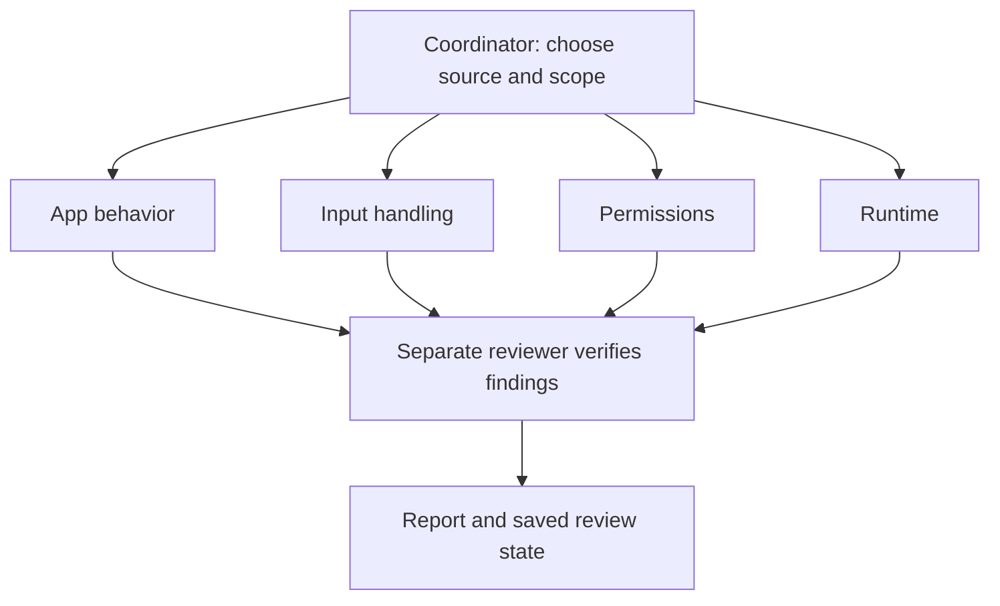

<div align="center">


A skill for Codex and Claude Code to review apps and websites with multiple agents.

[Get started](#get-started) &nbsp;·&nbsp; [Review process](#review-process) &nbsp;·&nbsp; [CLI](#cli) &nbsp;·&nbsp; [Reports](#reports) &nbsp;·&nbsp; [Docs](#docs)

</div>

---

HydraScan splits a review between agents looking at app behavior, input handling, permissions and runtime issues. Important findings get a separate verification pass. The report records the evidence, what was tested and what still needs checking.

The included Python CLI collects source files, flags possible issues and runs checks you choose. Your coding agent handles the review and agent coordination.

## Get started

Use **Codex or Claude Code**. The CLI requires **Python 3.10+**; JavaScript/TypeScript AST analysis has an optional Node/Babel setup below. The base runner uses the Python standard library and needs no separate scanner, Docker or API key.

### 1. Install

**Codex** — ask:

```text
Use $skill-installer to install
Omern187/HydraScan at
skills/hydrascan.
```

**Claude Code** — clone or download this repository, then copy the entire [skills/hydrascan](skills/hydrascan) folder to `~/.claude/skills/hydrascan`. For one project, use `.claude/skills/hydrascan` inside that project. Start a new session and invoke `/hydrascan`. [Claude Code skill docs](https://code.claude.com/docs/en/skills)

<details>
<summary>Manual Codex installation</summary>

Copy the entire [skills/hydrascan](skills/hydrascan) folder to `~/.codex/skills/hydrascan`, or `$CODEX_HOME/skills/hydrascan` if configured. Include the scripts and references. The skill is available on the next turn.

</details>

### 2. Run your first review

Open the project you want to review. In **Codex**, ask:

```text
Use $hydrascan to review this app
for bugs and security issues.
Split the work between agents,
verify findings, and save tested
paths and remaining checks.
```

In **Claude Code**, use:

```text
/hydrascan Review this app for bugs
and security issues. Use separate
reviewers, verify findings, and save
tested paths and remaining checks.
```

The review saves a report and `review-state.md` so you can continue later.

<details>
<summary>Using HydraScan in Claude chat</summary>

From a committed checkout, build a skill-only ZIP:

```sh
git archive --format=zip --output=hydrascan-skill.zip HEAD:skills
```

Upload it through Claude's custom Skills interface with code execution enabled. The ZIP contains `hydrascan/SKILL.md` and its scripts and references. Uploading the skill doesn't give Claude access to your local app; the reviewed source must be separately accessible within the authorized workflow.

Chat capabilities vary. HydraScan uses available files and tools, runs review lanes sequentially when delegation is unavailable, and records missing execution or runtime access. Use Claude Code for a local repository workflow. [Host details](skills/hydrascan/references/hosts.md) · [Claude upload guide](https://support.claude.com/en/articles/12512180-use-skills-in-claude)

</details>

<details>
<summary>Review GitHub code, resume a review, or apply fixes</summary>

The prompts below use Codex syntax. In Claude Code, replace `Use $hydrascan to` with `/hydrascan`.

**GitHub repository**

```text
Use $hydrascan to review owner/repository from GitHub.
Check out the current main commit in a separate directory
and include the commit hash in the report.
```

**Resume**

```text
Use $hydrascan to continue from review-state.md.
Check that the source revision matches and work through
the remaining checks.
```

**Fix confirmed issues**

```text
Use $hydrascan to fix the confirmed issues in the saved report
and run regression checks for the affected behavior.
```

</details>

## Review process

| Reviewer | Looks for |
| --- | --- |
| **App behavior** | Wrong calculations, broken imports/exports, stale state, races, lost data and errors shown as success. |
| **Input handling** | SQL and command injection, XSS, SSRF, unsafe file paths, archive extraction and parser errors. |
| **Permissions** | Missing access checks, another user's records, tenant isolation, session issues and data exposure. |
| **Runtime** | Broken launchers, release files, dependencies, resource limits, deployment settings and Electron permissions. |



Reviewers start with the same source revision and separate assignments. Findings are compared after discovery. Work runs in batches or sequentially when the host has fewer agent slots.

In Claude Code, the coordinator passes each reviewer the skill instructions and scope explicitly. No custom agent configuration or experimental agent-team setting is required.

The review tracks **32 risk categories**, including unfinished checks. The CLI supports selected Python flows across files, SQL/ORM access patterns and optional JavaScript/TypeScript AST analysis. Unsupported paths are recorded for manual review. [Analysis limits](skills/hydrascan/references/project-analysis.md) · [Agent workflow](skills/hydrascan/references/multi-agent-review.md)

## CLI

Clone the repository, then run the commands from its root:

```sh
git clone https://github.com/Omern187/HydraScan.git
cd HydraScan
python skills/hydrascan/scripts/hydrascan.py doctor
python skills/hydrascan/scripts/hydrascan.py scan ../my-app --output ../hydrascan-run
python skills/hydrascan/scripts/hydrascan.py collect ../hydrascan-run
```

Replace `../my-app` with your app's source directory. Use a **new output directory outside that source**. For an installed skill, use the script in its installed folder.

| Command | Result |
| --- | --- |
| `doctor` | Reports runtime and optional parser availability. |
| `scan` | Copies a bounded source snapshot, flags possible issues and saves review files. |
| `collect` | Refreshes saved summaries while keeping manual notes. It doesn't rerun checks or scan changed code. |

The CLI prepares material for review. It doesn't start AI agents or complete a security assessment on its own.

<details>
<summary><strong>Optional: JavaScript / TypeScript AST analysis</strong></summary>

Install the pinned Babel parser separately from the app being reviewed. The parser manifest requires **Node `^22.18.0 || >=24.11.0`**.

```sh
npm ci --prefix skills/hydrascan/scripts/javascript-parser
python skills/hydrascan/scripts/hydrascan.py doctor
```

For another installation location, pass `--js-parser-root /path/to/parser-runtime` or set `HYDRASCAN_JS_PARSER_ROOT`. The directory must contain the installed `node_modules`. Use `--node` or `HYDRASCAN_NODE` to choose a Node executable.

If the parser is unavailable or fails, the runner uses limited text analysis and records the gap in `analysis-gaps.json`. It doesn't install packages or load the reviewed app's parser configuration automatically. [Parser manifest](skills/hydrascan/scripts/javascript-parser/package.json)

</details>

<details>
<summary><strong>Optional: run the app's tests</strong></summary>

Create `checks.json` with commands you've inspected and want to run:

```json
[
  {
    "name": "unit tests",
    "argv": ["python", "-m", "unittest", "discover", "-s", "tests", "-v"],
    "timeout": 60
  }
]
```

Use another new output directory:

```sh
python skills/hydrascan/scripts/hydrascan.py scan ../my-app --output ../hydrascan-tests --checks checks.json
```

Commands run one at a time in the source snapshot with explicit argument arrays. Windows batch launchers such as `npm.cmd` use Windows command processing; arguments containing shell operators or expansions are rejected. **The snapshot is not a sandbox:** processes can still access your machine and network. Run untrusted code in a contained disposable environment. [Runner details](skills/hydrascan/references/engine.md)

</details>

## Reports

A run saves these files, along with the snapshot and supporting metadata:

```text
hydrascan-run/
├── report.md                    Summary and agent review notes
├── review-state.md              Saved state for continuing the review
├── coverage.json                Checked and unfinished risk categories
├── candidates.json              Possible issues that need review
├── security-review-tasks.json   Open ownership and permission questions
├── analysis-gaps.json           Unsupported or failed analysis
├── inventory.json               Included and excluded source files
└── checks.json                  Results of selected test commands
```

A finding includes the affected code, expected and observed behavior, impact, and how it was checked. Its status tells you what evidence is available:

| Status | Meaning |
| --- | --- |
| `candidate` | Needs more evidence or clarification about intended behavior. |
| `source-confirmed` | Supported by a complete, reachable code path. |
| `dynamic-confirmed` | Reproduced in a runtime or component test; substitutions are disclosed. |
| `hardening` | An improvement without a demonstrated vulnerability. |

Static warnings don't automatically become confirmed vulnerabilities. Passing tests or adding agents doesn't establish that every path has been checked.

## Development

Run the tooling tests from the repository root:

```sh
python -m unittest discover -s tests -v
```

Revision **2026-10-11.1** passed **257 tooling tests** with Babel available. These check HydraScan's runner and analysis, not the security of another app. AST-specific test classes are skipped when the optional parser isn't installed. Tests cover mixed Python/JavaScript scans, credential snapshots and logs, Windows execution, Flask input forms, path/template boundaries and authorization controls.

Synthetic reviews found missed issues and false positives. Those cases informed fixes and regression tests; passing them again doesn't establish detection rates for other projects.

## Docs

| Guide | Contents |
| --- | --- |
| [Skill instructions](skills/hydrascan/SKILL.md) | Full workflow and when to use it. |
| [Host support](skills/hydrascan/references/hosts.md) | Codex, Claude Code, custom-skill upload and capability differences. |
| [Runner](skills/hydrascan/references/engine.md) | Commands, checks, snapshots and saved files. |
| [Source analysis](skills/hydrascan/references/project-analysis.md) | Supported code patterns and limitations. |
| [Agent coordination](skills/hydrascan/references/multi-agent-review.md) | Assignments, scheduling and independent verification. |
| [Coverage](skills/hydrascan/references/coverage.md) | Risk categories and unfinished work. |
| [Security validation](skills/hydrascan/references/security-validation.md) | Evidence needed to accept a security finding. |
| [Functional bugs](skills/hydrascan/references/functional-bugs.md) · [Test ideas](skills/hydrascan/references/behavioral-probes.md) | Behavior checks and failure cases. |
| [Reporting](skills/hydrascan/references/reporting.md) | Finding records and continuation notes. |

## Scope and limits

Use HydraScan on code and systems you're authorized to test. Prefer local instances or staging with synthetic data. Production changes, additional hosts, paid runs and external reporting need their own authorization.

The source snapshot skips links, dependency/Git directories, known secret files, binaries and oversized files. Check the inventory for exclusions. Included code may still contain secrets; review reports before sharing them and keep raw logs private.

The runner doesn't automatically install app dependencies, run discovered commands, scan HTTP targets, call model providers or upload source. Your coding agent can add authorized local or staging checks to the assessment. HydraScan doesn't guarantee discovery of every vulnerability or certify compliance.

---

[Report an issue](https://github.com/Omern187/HydraScan/issues) · [Credits and history](skills/hydrascan/references/provenance.md)

No project license is specified in this repository.
