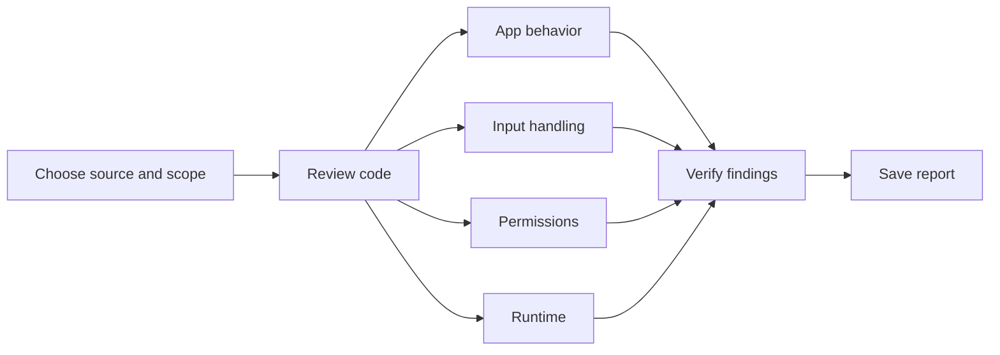

HydraScan is a Codex skill for reviewing apps and websites for bugs and security issues. It splits the review between agents, checks their findings, and saves a report you can pick up later.

It includes a Python CLI for collecting source files, flagging suspicious code and running checks you choose. The code review happens through your coding agent. The CLI can be used on its own, but it won't start agents or produce a full security assessment by itself.

## Install

Ask Codex:

```text
Use $skill-installer to install the skill from Omern187/HydraScan at skills/hydrascan.
```

Or copy [skills/hydrascan](skills/hydrascan) to `~/.codex/skills/hydrascan` (or `$CODEX_HOME/skills/hydrascan`). Copy the whole folder, including its scripts and references. The skill is available on the next turn.

## Use

In the project you want to review:

```text
Use $hydrascan to check this app for bugs and security issues. Split the work between agents, verify the findings, and save a report with what was tested and what still needs checking.
```

To review a repository from GitHub:

```text
Use $hydrascan to review owner/repository from GitHub. Check out the current main commit in a separate directory and include the commit hash in the report.
```

To continue a saved review:

```text
Use $hydrascan to continue from review-state.md. Check that the source revision matches and work through the remaining checks.
```

## What it checks

| Area | Examples |
| --- | --- |
| App behavior | Wrong calculations, broken imports and exports, stale state, race conditions, lost data and errors shown as success. |
| Input handling | SQL and command injection, XSS, SSRF, unsafe file paths, archive extraction and parser errors. |
| Access control | Missing permission checks, access to another user's records, tenant isolation, session handling and data exposure. |
| Startup and deployment | Broken launchers, release files, dependencies, resource limits, configuration and Electron permissions. |

The CLI handles selected Python flows across files, SQL/ORM access patterns, and JavaScript/TypeScript analysis. Support depends on the code structure; unresolved paths are recorded for manual review. See [supported analysis and limitations](skills/hydrascan/references/project-analysis.md).

## How the agents work

One agent coordinates the review. Other agents look at app behavior, input handling, permissions, and runtime issues. A separate reviewer tries to reproduce or disprove the important findings.



Each reviewer starts with the same source revision and their own assignment. Findings are compared after discovery. The number of agents depends on what the host supports; work runs in batches or sequentially when necessary.

The review tracks 32 risk categories, including checks that haven't been completed. More agents don't guarantee that every bug will be found. [Agent workflow](skills/hydrascan/references/multi-agent-review.md) · [Coverage tracking](skills/hydrascan/references/coverage.md)

## CLI

Requires **Python 3.10+**. The base runner uses the standard library, with no separate scanner engine, Docker or API key required.

From this repository:

```text
python skills/hydrascan/scripts/hydrascan.py doctor
python skills/hydrascan/scripts/hydrascan.py scan /path/to/app --output /path/to/new-run
python skills/hydrascan/scripts/hydrascan.py collect /path/to/new-run
```

Use a new output directory outside the app's source. `scan` saves the file inventory, possible issues, check results, coverage, a report and `review-state.md`. `collect` updates saved summaries without rerunning tests or scanning changed code.

<details>
<summary>JavaScript and TypeScript parser setup</summary>

For JS/TS/JSX AST analysis, install the pinned Babel parser separately from the app being reviewed. Use a Node version supported by [package.json](skills/hydrascan/scripts/javascript-parser/package.json).

```text
npm ci --prefix skills/hydrascan/scripts/javascript-parser
python skills/hydrascan/scripts/hydrascan.py doctor
```

For another installation location, pass `--js-parser-root /path/to/parser-runtime` or set `HYDRASCAN_JS_PARSER_ROOT`. The directory must contain the installed `node_modules`. Use `--node` or `HYDRASCAN_NODE` to choose a Node executable.

If the parser is unavailable or fails, the runner falls back to limited text analysis and records the gap in `analysis-gaps.json`. It doesn't install packages or load the reviewed app's parser configuration automatically.

</details>

<details>
<summary>Running the app's tests</summary>

Create a `checks.json` with the commands you've inspected and want to run:

```json
[
  {
    "name": "unit tests",
    "argv": ["python", "-m", "unittest", "discover", "-s", "tests", "-v"],
    "timeout": 60
  }
]
```

```text
python skills/hydrascan/scripts/hydrascan.py scan /path/to/app --output /path/to/new-run --checks /path/to/checks.json
```

Commands run one at a time in the source snapshot, without a shell. The snapshot is **not a sandbox**: processes can still access your machine and network. Run untrusted code in a contained disposable environment. [CLI details](skills/hydrascan/references/engine.md)

</details>

## Reports

A finding includes the affected code, what should happen, what actually happens, the impact, and how it was checked. Issues are marked as:

- `candidate` — needs more evidence or clarification about intended behavior.
- `source-confirmed` — supported by a complete code path.
- `dynamic-confirmed` — reproduced in a runtime or component test, with any substitutions explained.
- `hardening` — a suggested improvement without a demonstrated vulnerability.

The report also lists untested paths and missing evidence. Static warnings don't automatically become confirmed vulnerabilities, and passing tests don't clear the rest of the app.

To apply fixes after a review:

```text
Use $hydrascan to fix the confirmed issues in the saved report and run regression checks for the affected behavior.
```

## Tests

```text
python -m unittest discover -s tests -v
```

Revision **2026-10-10.10** passed **157 tooling tests** with Babel available. These test HydraScan's runner and analysis, not the security of a reviewed app. The AST test class is skipped if the optional parser isn't installed.

Separate synthetic reviews found missed issues and false positives. Fixes were checked against those cases and added to regression tests. Passing the same cases again doesn't establish detection rates for other projects.

## Further reading

- [Skill instructions](skills/hydrascan/SKILL.md)
- [Runner and saved files](skills/hydrascan/references/engine.md)
- [Security finding validation](skills/hydrascan/references/security-validation.md)
- [Functional bugs](skills/hydrascan/references/functional-bugs.md) and [test ideas](skills/hydrascan/references/behavioral-probes.md)
- [Report format](skills/hydrascan/references/reporting.md)

## Scope and limits

Use HydraScan on code and systems you're authorized to test. Prefer local test instances or staging with synthetic data. Production changes, additional hosts, paid runs and external reporting need their own authorization.

The source snapshot skips links, dependency/Git directories, known secret files, binaries and oversized files. Check the inventory for exclusions. Included code may still contain secrets, so review reports before sharing them and keep raw logs private.

The runner doesn't automatically install app dependencies, run discovered commands, scan HTTP targets, call model providers or upload source. Your coding agent can run authorized local or staging checks and add the results to the report. HydraScan doesn't guarantee that it will find every vulnerability or certify compliance.

[Credits and project history](skills/hydrascan/references/provenance.md)
